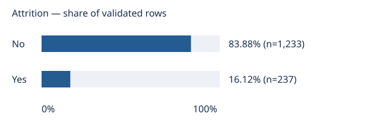

# Attrition EDA — overall distribution

**237 of 1,470 validated rows (16.12%) have Attrition = Yes.**
The remaining 1,233 (83.88%) have Attrition = No.
This first descriptive slice summarizes labels, not reasons for leaving.

## Evidence and method

- [Label counts and percentages](data/attrition-counts.csv) use all validated rows as denominator.
- [Overview](data/overview.csv) includes the majority-label share: 83.88%.
  Always predicting the more common label would obtain this in-sample accuracy;
  this is not held-out evaluation or a trained model. Accuracy alone can hide
  poor detection of the minority class; T3 must compare held-out class-sensitive metrics.
- Input must pass the unchanged intake contract (1,470 rows, 35 ordered columns,
  valid values, unique identifiers, both labels). No cleaning or row exclusion occurs.
- Percentages are rounded to two decimals; tables and figure have fixed label order.
  Outputs contain only global aggregates, no employee-level records or identifiers.
- Structural validation establishes compatibility, not authenticity. Reproduce from
  the same locally validated source bytes; acquisition may change upstream.

## Limitations and next slice

The source is described as fictional IBM data. These are descriptive sample
frequencies, not population estimates, causal effects, or an annual attrition rate:
no observation window or sampling design is established here. Global counts do
not establish subgroup differences or explain attrition. No uncertainty intervals
are offered without a justified sampling model. Do not use this work for individual
employment decisions. Subgroup exploration, modeling, and a demo remain future work.

## Source and attribution

Contains information from [IBM HR Analytics Employee Attrition & Performance](https://www.kaggle.com/datasets/pavansubhasht/ibm-hr-analytics-attrition-dataset),
made available under the [Open Database License (ODbL) 1.0](https://opendatacommons.org/licenses/odbl/1-0/);
contents are licensed under [DbCL 1.0](https://opendatacommons.org/licenses/dbcl/1-0/).
No raw data is redistributed. See [project instructions](../README.md) for acquisition
and regeneration. Validation does not establish redistribution clearance.
